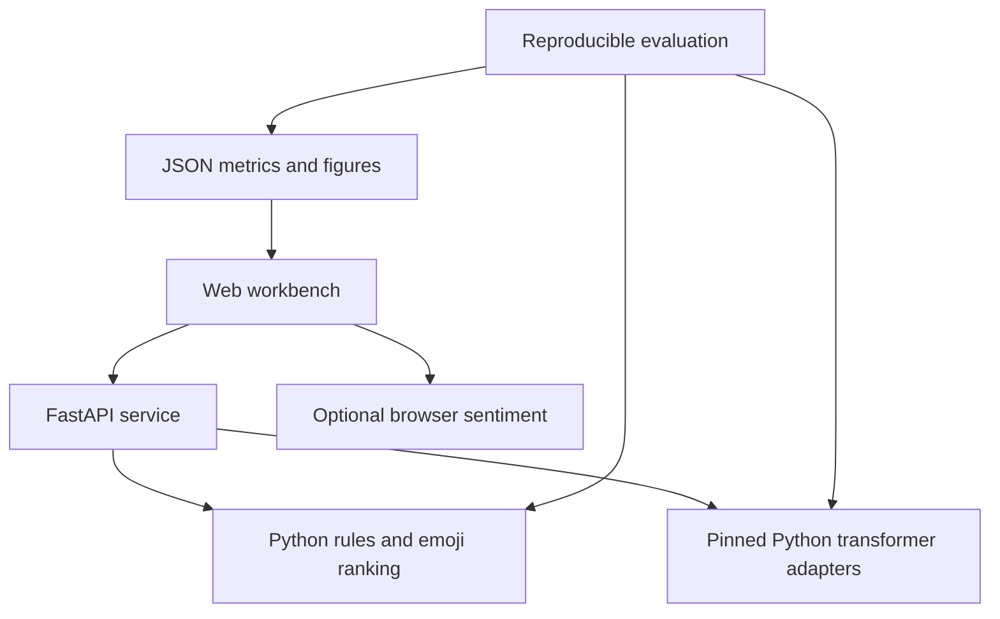

# NLP Application Suite

An English-language NLP workbench prepared for Divyansh Singh’s research portfolio. It preserves a transparent Python sentiment/emoji baseline and adds pretrained transformer inference, explanations, batch analysis, and reproducible evaluation. This is a newly built project; it does not claim a historical implementation, novel model training, or professor endorsement.

## Interface

The responsive web interface includes analysis, batch processing, preprocessing, evaluation and model cards. A real screenshot is pending: the available browser could not launch under this runtime’s socket restrictions.

## Features

- Three-class sentiment: negative, neutral and positive.
- Rule emotion detection and a six-class pretrained Python emotion classifier.
- Negation scope, intensifiers, punctuation emphasis and simple emoji matching.
- Rule evidence and optional transformer token-deletion sensitivity (first 16 word positions).
- Confidence type, scores, uncertainty and processing latency shown explicitly.
- Deterministic top-3 emoji recommendations with keyword priority; no learned emoji accuracy claimed.
- UTF-8 CSV/TXT batches with selectable text column, aggregate counts, 1 MB / 100-row limits, and formula-safe CSV export.
- Optional normalization, tokenization, stop-word handling, educational suffix stemming and 1–3 grams. Negation words are retained. No lemmatizer is claimed.
- Comparison of Python rules/transformers with disagreement notices; browser-only ONNX sentiment and emotion alternatives, with quantized or full precision modes.
- Evaluation dashboard with confusion matrices, class metrics, calibration plots and error indices filtered by class/confidence.
- No application persistence of submitted text, no credentials required for public model downloads, sanitized server errors.
- FastAPI OpenAPI documentation, automated tests, Ruff, MyPy, CI and a container definition.

## Architecture



A small HTML/CSS/JavaScript interface is used instead of Streamlit because the requested deployment provider is Vercel. Local/container installations expose full Python transformer inference. Vercel defaults to the lightweight rule API; the browser worker supplies sentiment and emotion inference. The website now supports ONNX transformer inference for both sentiment and emotion, token-deletion explanations, comparison and transformer batches. A fast quantized mode is the default; full precision is available for closer numerical agreement with Python. The browser model has not been benchmarked by the Python evaluation, and its results may differ.

## Setup — Linux/macOS

Python 3.11–3.13 is required. `requirements-ml-lock.txt` records the full tested Python 3.12 CPU environment; for exact reproduction install it with the PyTorch CPU extra index before `pip install -e .`. From the repository root:

```bash
python3 -m venv .venv
source .venv/bin/activate
python -m pip install -e '.[dev]'
uvicorn app.main:app --reload --no-access-log
```

Open http://localhost:8000 and http://localhost:8000/docs.

To enable both Python transformers:

```bash
python -m pip install -e '.[ml]' --extra-index-url https://download.pytorch.org/whl/cpu
export ENABLE_TRANSFORMERS=1
export OMP_NUM_THREADS=2
uvicorn app.main:app --reload --no-access-log
```

## Setup — Windows PowerShell

```powershell
py -3.12 -m venv .venv
.\.venv\Scripts\Activate.ps1
python -m pip install -e ".[dev]"
uvicorn app.main:app --reload --no-access-log
```

For Python transformer inference:

```powershell
python -m pip install -e ".[ml]" --extra-index-url https://download.pytorch.org/whl/cpu
$env:ENABLE_TRANSFORMERS="1"
$env:OMP_NUM_THREADS="2"
uvicorn app.main:app --reload --no-access-log
```

Activation can be skipped by invoking `.venv/Scripts/python.exe` directly. `.env.example` lists optional settings; this app does not automatically read `.env`. Export settings before launching. Default confidence threshold is 0.60.

### Downloads and resources

Python models load lazily on first transformer request. Hugging Face caches weights outside source control; `HF_HOME` may override the location. Plan approximately 2 GB free disk and 2–4 GB available RAM for both CPU models plus dependencies; these are estimates, not measured hardware requirements. The browser transformer option downloads ONNX weights on first use, potentially over 100 MB, and uses the browser cache. It requires network access to jsDelivr, Hugging Face and ONNX runtime assets. Browser transformer inference runs on-device, but baseline analysis and batch validation also send the text to the API. No API key is needed.

## Models

| Task | Exact model | Revision | License | Selection reason |
|---|---|---|---|---|
| Sentiment | [cardiffnlp/twitter-roberta-base-sentiment-latest](https://huggingface.co/cardiffnlp/twitter-roberta-base-sentiment-latest) | `3216a57f2a0d9c45a2e6c20157c20c49fb4bf9c7` | CC BY 4.0 | English three-class output; contextual social-language baseline |
| Emotion | [bhadresh-savani/distilbert-base-uncased-emotion](https://huggingface.co/bhadresh-savani/distilbert-base-uncased-emotion) | `ce6f4ffcde7642ca2cac02381a16da38e5498ff7` | Apache 2.0 | Smaller DistilBERT with the same six labels as the selected research dataset |
| Browser sentiment | [Xenova/twitter-roberta-base-sentiment-latest](https://huggingface.co/Xenova/twitter-roberta-base-sentiment-latest) | `f3ec4d0925f90c3ca7ee7814f52d6ee7cf180445` | Upstream CC BY 4.0; conversion card has no independent license declaration | Quantized ONNX conversion for optional client-side sentiment; not a separately evaluated model |

Read [MODEL_CARD.md](MODEL_CARD.md). Official model cards describe pretraining/fine-tuning; published upstream scores are not presented as this project’s results.

## Datasets and evaluation

| Task | Dataset | License/restriction | Split protocol |
|---|---|---|---|
| Sentiment | [Financial PhraseBank](https://huggingface.co/datasets/takala/financial_phrasebank), `sentences_allagree` | CC BY-NC-SA 3.0, noncommercial | Deduplicate normalized text, stratify each label into 70/15/15 with seed 42; no official split exists |
| Emotion | [DAIR-AI Emotion](https://huggingface.co/datasets/dair-ai/emotion), `split` | Card declares `other`: educational and research purposes only | Official 16,000/2,000/2,000 train/validation/test, then remove normalized duplicates across splits |

The sentiment experiment tests a social-media classifier on financial language. DAIR emotion is an in-domain pretrained-model reproduction, not evidence of new training. Its labels were obtained through an automated distant-supervision process and can be noisy. These data restrictions do not extend the MIT source-code license to datasets or weights. Raw downloaded data stays ignored; no benchmark texts are redistributed in reports. TweetEval was considered but its dataset card declares an unknown license, so it is not redistributed or used here.

```bash
python -m pip install -e '.[ml]' --extra-index-url https://download.pytorch.org/whl/cpu
python -m scripts.download_data
OMP_NUM_THREADS=2 python -m scripts.evaluate --engine both --task both
python -m scripts.export_results
```

PowerShell: set `$env:OMP_NUM_THREADS="2"` before running `python -m scripts.evaluate --engine both --task both`.

Optional smoke subset: `python -m scripts.evaluate --engine both --limit 50`. Subset runs are explicitly labeled and must not be compared to full benchmark runs. Running evaluation replaces the report for the selected task/engine; `export_results` updates this README from JSON. Rules and thresholds are frozen before test evaluation; train and validation are retained for future development only. Never tune on the test set.

Results include accuracy, macro/weighted F1, per-class precision/recall/F1, class distribution, a confusion matrix, normalized duplicate counts, latency excluding model load/warm-up, confidence coverage, expected calibration error and environment versions. Macro F1 exposes weak performance on minority classes. Unknown rule emotions count as wrong rather than being silently assigned a class; macro F1 averages the six target classes. Duplicate normalization detects likely textual leakage, not all semantic overlap or pretrained corpus contamination.

<!-- METRICS_START -->
| Task | Engine | Test examples | Accuracy | Macro F1 | Weighted F1 | Scope |
|---|---|---:|---:|---:|---:|---|
| sentiment | rules | 340 | 0.6765 | 0.4289 | 0.6081 | full held-out test |
| sentiment | transformer | 340 | 0.7176 | 0.5831 | 0.6681 | full held-out test |
| emotion | rules | 1986 | 0.0755 | 0.1416 | 0.1313 | full held-out test |
| emotion | transformer | 1986 | 0.9325 | 0.8904 | 0.9322 | full held-out test |
<!-- METRICS_END -->

See [reports/summary.md](reports/summary.md), [reports/metrics.json](reports/metrics.json) and [reports/error_analysis.md](reports/error_analysis.md). No estimated metrics are substituted for an unperformed run.

## API

| Method | Endpoint | Purpose |
|---|---|---|
| GET | `/health` | Service health and transformer configuration |
| POST | `/analyze` | Rules, Python transformer or comparison |
| POST | `/batch` | Validated CSV/TXT, JSON or safe CSV |
| POST | `/preprocess` | Educational processing stages |
| GET | `/models` | IDs, revisions, labels, licenses and mappings |
| GET | `/metrics` | Generated evaluation report |
| GET | `/docs` | Interactive OpenAPI documentation |

```bash
curl http://localhost:8000/health
curl -X POST http://localhost:8000/analyze -H 'Content-Type: application/json' \
  -d '{"text":"I am not happy with this result.","engine":"compare","explain":false}'
curl -X POST http://localhost:8000/batch \
  -F 'file=@data/samples/example.csv' -F 'column=text' -F 'output=csv'
```

PowerShell:

```powershell
Invoke-RestMethod http://localhost:8000/analyze -Method Post -ContentType "application/json" -Body '{"text":"This is great","engine":"rules"}'
```

Example baseline sentiment fields for `This is great` (full response includes emotion, emoji suggestions, evidence and latency):

```json
{"label":"positive","confidence_kind":"uncalibrated rule support","uncertain":false}
```

Validation returns 422, oversized request bodies return 413, and unavailable Python-only transformer requests return 503. Comparison returns the baseline plus a clear `transformer_error` if the transformer cannot run. Malformed requests never masquerade as successful inference.

## Quality and container

```bash
python -m pip install -e '.[dev]'
ruff check .
ruff format --check .
mypy
pytest -m 'not live'
RUN_LIVE_MODELS=1 pytest -m live
docker build -t nlp-suite .
docker run --rm -p 8000:8000 nlp-suite
```

PowerShell live test: `$env:RUN_LIVE_MODELS="1"; pytest -m live`. Most tests mock model adapters; the live smoke test opts into downloads. GitHub Actions runs non-network tests, lint, formatting and typing, plus a separate Docker build/health job. Presence of CI is not a claim that remote CI has passed.

## Deployment

The app is deployed at https://nlp-application-suite.vercel.app/. Vercel runs the lightweight rule API, preprocessing, batch validation and evaluation endpoints. Python transformers remain disabled in this serverless bundle; the default website engine runs both transformer tasks in a Web Worker using Transformers.js 2.17.2. A local server with `ENABLE_TRANSFORMERS=1` automatically uses Python models instead.

The browser sentiment model is the pinned Xenova conversion listed above. Browser emotion uses `TrumpMcDonaldz/bhadresh-savani-distilbert-base-uncased-emotion-ONNX`, revision `17dd05bd2206a495d9b796e4103cb0089cdc59be` (Apache 2.0), whose configuration identifies the same upstream Bhadresh Savani DistilBERT classifier and six labels. Its ONNX filename is `decoder_model_merged`; this is passed explicitly to the classification pipeline. Model conversion provenance is distinct from verifying bit-for-bit weight equality.

Select **Transformers · sentiment + emotion** for contextual analysis or **Compare rules + transformers** for side-by-side results. Token deletion explanations run for both tasks, bounded to 16 word positions. Batch analysis validates uploads through the API and then runs both transformers sequentially in the browser. Safe CSV export contains the selected engine's predictions; failed inference does not silently export rule results as transformer results.

First use downloads roughly 200 MB in fast mode and substantially more in full precision mode; both models stay cached by the browser where supported. A reliable connection, a modern browser and sufficient device memory are required. ONNX conversion, quantization and numerical runtime differences can change scores and occasionally labels. The Python benchmark dashboard is unchanged and must not be interpreted as browser-model evaluation. Full local Python parity would require hosting the exact Python models on a persistent inference backend.

## Privacy, limitations and design decisions

No application database, analytics or submitted-text logging is configured. Use `--no-access-log` for local serving; reverse proxies/platforms can retain request metadata. JSON errors are sanitized. CSV exports neutralize formula-like cells. Upload names are never used to write filesystem paths. Inputs are English-only in practice: Unicode support is not multilingual model support. Keep this research demo away from automated clinical, hiring, disciplinary or other high-stakes decisions.

Rule support is not calibrated probability. Mixed or unseen words may be wrong despite a high support value. Emotion has no neutral transformer class. Emoji ranking is a deterministic heuristic with no learned benchmark claim. Transformer inputs are truncated to 256 subword tokens; word deletion explanations are bounded and context-dependent. Crisis keyword matching is incomplete and unreliable, and only supplies a neutral human-support message.

The suite is a small educational/research app, not a production multi-user service: no authentication, durable rate limiting, request queue or service-level guarantee is implemented. Inference deadlines and model failures are surfaced. API batch inference is deliberately limited to fast rules to avoid long serverless execution. See the cards for dataset domain and label-mapping loss.

## Contribution statement for Divyansh to review

Suggested first-person statement **after reviewing and taking ownership of this newly AI-assisted implementation**:

> I developed this NLP workbench with AI coding assistance and am studying its implementation. The project compares a transparent rule baseline with pretrained sentiment and emotion classifiers and includes evaluation scripts, model/data cards, error analysis, and an API. I did not train the pretrained transformers, and I distinguish measured results from planned experiments.

This statement is a draft for review, not verification of independent authorship or prior experience.

## Future research

Proposed, not implemented: add a knowledge graph of recommendation entities, compare vector retrieval to graph grounding, then evaluate traceable emotion-grounded recommendations with Recall@k, NDCG@k, factual faithfulness, safety violations and human relevance judgments. Establish consented data and independent held-out evaluation before making real-user benefit claims.

References: Malo et al. (2014), *Good debt or bad debt: Detecting semantic orientations in economic texts*; Saravia et al. (2018), *CARER: Contextualized Affect Representations for Emotion Recognition*; Loureiro et al. (2022), *TimeLMs: Diachronic Language Models from Twitter*. Official cards and original restrictions are linked above.
